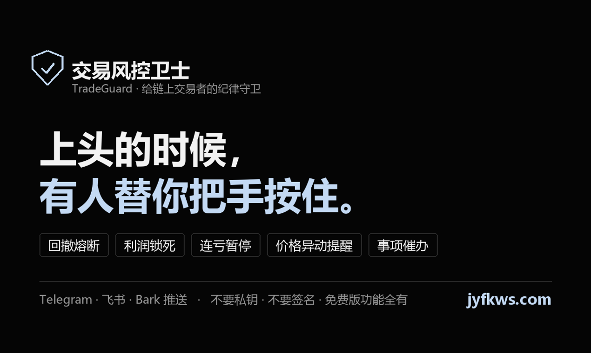
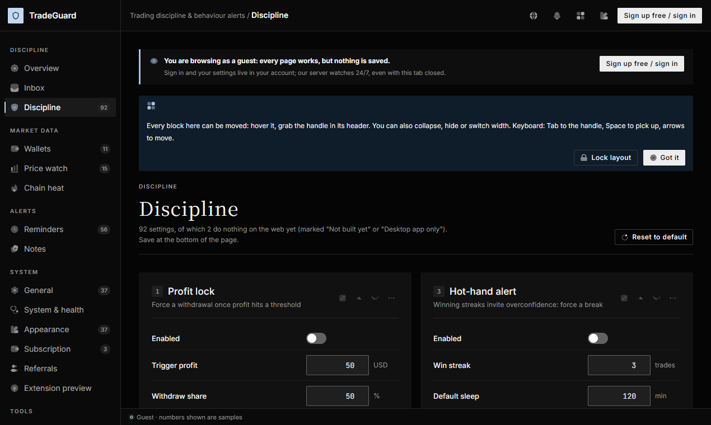
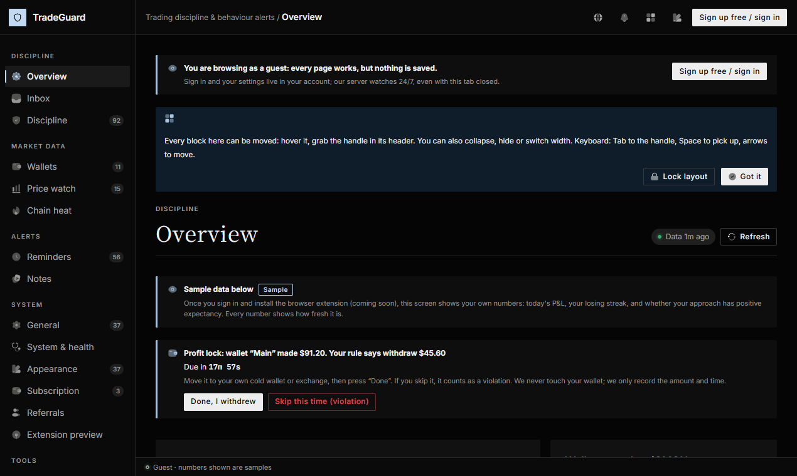
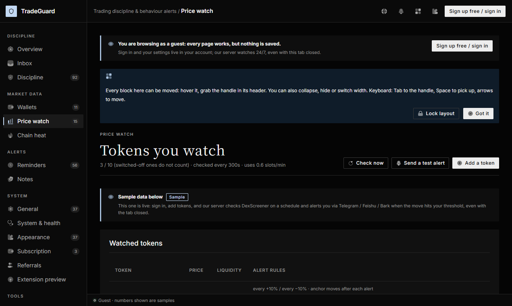
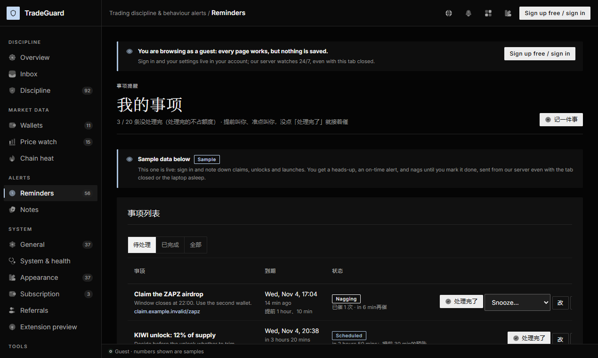

# TradeGuard · 交易风控卫士

**A discipline guard for on-chain memecoin traders.**
**给链上 Meme 交易者的纪律守卫：上头的时候，有人替你把手按住。**

[Website / 网站](https://jyfkws.com) · [Chrome Extension / 扩展](https://chromewebstore.google.com/detail/ecehclhcgeomkklleiaffgnkbpimogfp) · [Guide / 使用教程](https://jyfkws.com/docs) · [Features / 功能截图](https://jyfkws.com/features)

> This repository is the public home page, changelog and feedback tracker for TradeGuard.
> The product itself is a hosted service and is **not open source**. Bug reports and feature requests are welcome in [Issues](../../issues).
>
> 这个仓库是交易风控卫士的公开介绍页和反馈入口。产品本身是在线服务，**不是开源项目**。遇到问题、想要什么功能，欢迎在 [Issues](../../issues) 里提。

---

## 中文

你给自己定的交易规矩，平时都记得，上头的时候全忘了。交易风控卫士替你记着，阈值全由你自己定，服务器 24 小时在盯，网页关了也照样提醒。

### 它能做什么

- **交易纪律**：回撤熔断（到线就冷静，熔断期间打开交易网站先拦你一下）、连亏暂停、利润锁死、交易频率上限、手感极佳警报、久坐提醒。
- **钱包监控**：浏览器扩展用你自己的 GMGN API Key 读你自己钱包的成交和持仓，算今日盈亏、连亏、期望值。
- **价格监控**：Solana、BNB Chain、Base、以太坊上的代币，按涨跌幅、到价、市值上下穿提醒，带冷却时间和流动性门槛。
- **事项提醒**：空投领取、代币解锁、开盘、白名单截止，提前叫、准点叫，没点「处理完了」就接着催。
- **Meme 币模拟交易**：在 GMGN 页面上用模拟资金买卖、复盘，六条链各一个模拟账户，不连钱包、不碰真钱。
- **一键喊话小伙伴**：紧急时把一起盯盘的朋友的 iPhone 喊醒（通过对方的 Bark，能穿过静音），对方先同意才能喊，每条都能退订。
- **通知**：Telegram、飞书群机器人、Bark（iPhone「重要警告」静音也会响）、电脑系统通知。

### 安全

- 永远不要私钥、助记词、钱包签名。谁在网站上让你签名，那就不是我们。
- 不下单、不转账、不接交易所的交易权限。只读数据、只发提醒。
- GMGN API Key 只存在你自己的浏览器里，不上传。建 Key 时不用开交易权限。
- Bot Token 等凭据用 AES-256-GCM 加密保存，页面只显示掩码。

### 价格

免费版功能全都有。VIP 只加数量（多盯几个钱包、几个币）和刷新速度：28 USDT / 年，或 5 USDT / 月。

### 怎么开始

1. 打开 [jyfkws.com](https://jyfkws.com)，不注册也能先进去看（示例数据，改动不保存）。
2. 邮箱验证码、Telegram 或 Google 一键登录，不要密码。
3. 配一个通知通道，加上要盯的币 —— 价格提醒今天就能用。
4. 要判纪律的话装上 [Chrome 扩展](https://chromewebstore.google.com/detail/ecehclhcgeomkklleiaffgnkbpimogfp)，填 GMGN API Key（[三步拿到](https://jyfkws.com/gmgn-key)）。

---

## English

You know your own trading rules. You forget them the moment you are on tilt. TradeGuard remembers them for you, with every threshold set by you, and our server watches around the clock, with your tab closed or not.

### What it does

- **Discipline rules**: drawdown circuit breaker with a cool-down (the extension pauses you on trading sites while it is tripped), stop after a losing streak, profit lock, trade-frequency cap, hot-hand warning, sitting reminders.
- **Wallet tracking**: the Chrome extension reads your own wallet fills and positions with your own GMGN API key: today's PnL, losing streak, expectancy.
- **Price alerts**: tokens on Solana, BNB Chain, Base and Ethereum, on percentage moves, price targets and market-cap crossings, with cool-downs and a liquidity floor.
- **Reminders**: airdrop claims, unlocks, launches and whitelist deadlines, with a heads-up, an on-time call, and nagging until you mark it done.
- **Memecoin paper trading**: practise on GMGN pages with simulated funds across six chains. No wallet, no real money.
- **Buddy call**: wake an opted-in trading friend's iPhone through silent mode via Bark when something urgent happens.
- **Alerts on** Telegram, Feishu, Bark (iPhone critical alerts) and desktop notifications.

### Safety

Never asks for private keys, seed phrases or wallet signatures. Never places orders or moves funds. Your GMGN API key stays in your browser. Credentials are encrypted with AES-256-GCM.

### Pricing

Every feature is free. VIP only raises limits and refresh speed: 28 USDT / year or 5 USDT / month.

The interface is available in English, Simplified Chinese and Traditional Chinese (switch with the EN button). The guide is in Chinese for now.

---

## Screenshots

| Discipline rules | Overview |
|---|---|
|  |  |
| **Price alerts** | **Reminders** |
|  |  |

Screenshots are taken in guest mode, so numbers are samples.

## Disclaimer

TradeGuard only sends reminders and enforces the rules you set. It is not investment advice and never trades for you.
只做提醒和纪律约束，不构成投资建议，也不替你下单。
